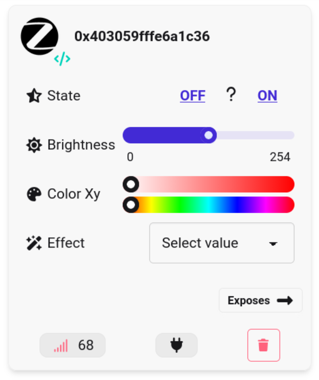
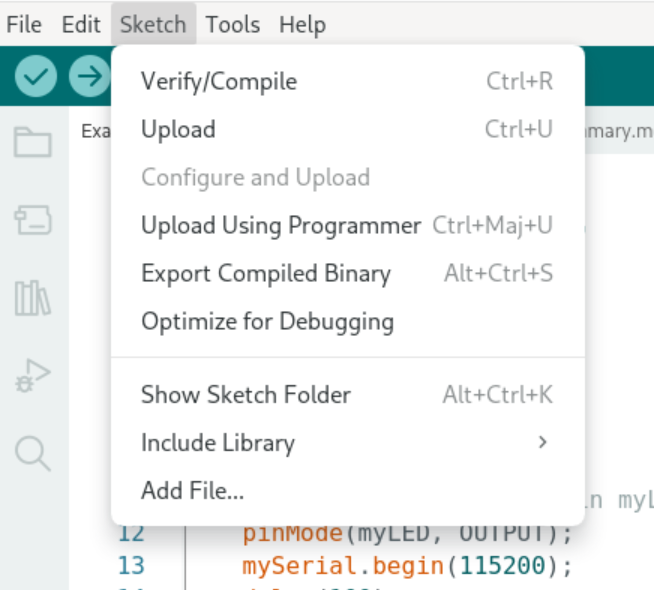

# EXT4_Zigbee_RGB



Based on the `EXT4_Matter_RGB` example

## Front-end

Tested with [Zigbee2MQTT](https://www.zigbee2mqtt.io/)

Install then launch

```bash
$
cd /opt/zigbee2mqtt
pnpm start
```


## RGB data transfer time

Tested with Arduino Nano Matter board with stacks Zigbee, Matter and None

Different profiles, specific for `ARDUINO_ZIGBEE`, `ARDUINO_MATTER` and general.

`-Os` optimization level is required to match the data transfer time of the WS2813C.

By default, Arduino uses the `-O0` optimization level, too slow to transfer the data.

* Uncheck **Sketch** > **Optimise for debugging**



* Refer to `platform.txt` under `.arduino15/packages/SiliconLabs/hardware/silabs/5.0.0`

```
compiler.optimization_flags=-Os
compiler.optimization_flags.release=-Os
compiler.optimization_flags.debug=-O0
```

If the colour does not show up accordingly, 

* Measure data transfer time with a logic analyser and adapt the profiles accordingly.

