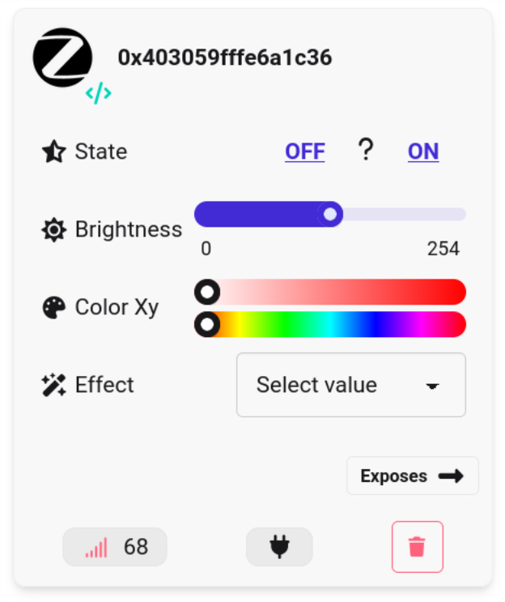

# EXT4_Zigbee_RGB



Based on the `EXT4_Matter_RGB` example

## Front-end

Tested with [Zigbee2MQTT](https://www.zigbee2mqtt.io/)

Install then launch

```bash
$
cd /opt/zigbee2mqtt
pnpm start
```

## RGB data transfer time

Tested with Arduino Nano Matter board

`-Os` optimization level is required to match the data transfer time of the WS2813C.

By default, Arduino uses the `-O0` optimization level, too slow to transfer the data.

Different profiles, specific for `ARDUINO_ZIGBEE` and general.

Measure data transfer time with a logic analyser and adapt the profiles accordingly.
