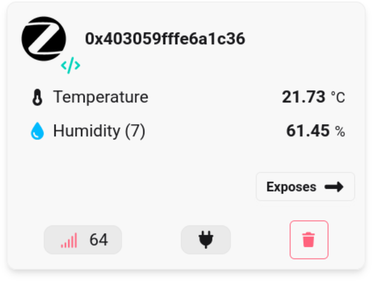

# EXT4_Zigbee_Weather



Based on the `EXT4_Matter_RGB` example

## Front-end

Tested with [Zigbee2MQTT](https://www.zigbee2mqtt.io/)

Install then launch

```bash
$
cd /opt/zigbee2mqtt
pnpm start
```
